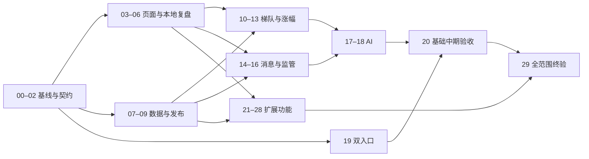

# DragonRadar 新版 PRD 改造实施计划

> **For agentic workers:** REQUIRED SUB-SKILL: Use superpowers:subagent-driven-development or superpowers:executing-plans to implement this plan task-by-task. Steps use checkbox (`- [ ]`) syntax for tracking. 复用已有代码；按任务约定验证，不再逐次重启整个项目的审查。

**Goal:** 基于现有累计分支交付完整新版工作台，包括全部原P0/P1/P2：盘后复盘、实时异动、席位、消息研究、研究回测/模拟与体验扩展；AI 独立降级，禁止真实交易和未来概率承诺。

**Architecture:** 保留行情/题材归档、Decimal 计算、现有 React 页面与编辑器，新增统一发布清单和面向页面的读模型。笔记与自选迁移到 IndexedDB；owner 会话只管理服务端受控操作，公开网关只提供已发布且具备公开展示许可的数据。

**Tech Stack:** 现有 Python/FastAPI/SQLAlchemy/PostgreSQL/Alembic、React/TypeScript/Vite/ECharts、原生 IndexedDB、BroadcastChannel、Docker/Caddy、pytest/Vitest/Playwright。现阶段保留 React 19 和自定义请求 hooks，不因 PRD 中的技术栈建议单独换库。

---

## 1. 基线、范围和交付原则

**状态：用户已批准本轮完整执行，Task01冻结契约。** 本文复选框仅由对应任务负责人凭实际验证更新，不表示其他任务已执行。不再请求原P1/P2范围审批；Task01文档作者仅负责六个指定文件，不修改Task00验收记录或提交代码。

需求来源：

- [新版 PRD](../../DragonRadar_开发需求PRD.md)，原始导入SHA256 `C37C93C6C1B47FC6F45E44F30602DD04DD6ECC9755790721EFF71B6771747C59`，本轮修订后不再代表当前文件。
- [差异清单](../../2026-09-20_新版需求与现有实现差异清单.md)，包括全部 57 个 REQ 和 29 项接口。
- [竞品报告](../../gushifupan竞品分析报告%20.html)，只用于展示与交互参考，不作为公式或数据授权证明。
- 累计实现基线：`feature/role-topic-evidence@1d1dd7605534ea774a031c70c33c270c00a6f6c0`。

采用**增量改造、按用户流程交付**。不采用从零重写，也不按旧 Task 7～15 顺序机械续做。先有可运行的导航、行情和本地复盘，再逐个接通数据域。

### 本轮范围修订与持续禁区

- 原P1/P2全部必交：实时看盘、分钟异动、龙虎榜席位、板块分时资金流、词云、轮动、自然语言查询、深色/密度/命令面板、回测、模拟组合、因子体检/滚动验证/条件调权、AI增益对照、0-100情绪研究分及阶段标签（Task21-28）。
- 研究功能明确标注公式、样本、版本与局限；不得输出未来上涨概率、假官方规则或真实交易。Task20仅基础中期验收，Task29才是完整范围终验。
- 不照搬暗盘、基因分及没有公开口径的竞品指标。
- 不继续扩展 PostgreSQL 私人笔记/自选为新版权威存储。
- 不删除旧业务数据、旧分支、工作树或重写提交历史；迁移完成后再独立安排清理。
- 不把本次计划当作 push、合并 main 或公开部署授权。

### 原有资产如何使用

| 保留 | 调整 | 新建 |
|---|---|---|
| domain/quality、analytics 纯函数、行情/题材 Repository | `api.py` 与 envelope、发布时预计算 | 页面读模型及公开路由装配 |
| Overview/Analysis/SecurityDetail、Chart、SnapshotHeader | 路由导航、证据区、基准与字段 | News/Leaders/Regulation 页面 |
| NoteEditor、ConflictDialog、Watchlist 的交互 | 将私人 HTTP 访问替换成本地 Repository | IndexedDB、事务回读、备份恢复 |
| owner 配对、cookie、CSRF 与来源校验 | 与本地笔记解耦、双网关部署 | AI 任务与审核、监管规则与消息服务 |
| 六类 evaluator、history、现有回归样例 | 只接新 PRD 所需规则；明确旧规则版本 | 角色结果持久化及证据投影 |

## 2. 已冻结的实施决策

下列决策消除主要歧义，详见 [冻结记录](../specs/2026-09-20-prd-reset-decisions.md) 和 [API契约](../../contracts/workbench-api.md)。本轮范围修订覆盖原延期文字，数据许可与研究安全边界继续有效。

| 编号 | 计划选择 | 实施位置 |
|---|---|---|
| DEC01 | 热力图采用日期×板数家数；26号竞品概念×日期涨幅截图非该算法证据；概念收益/轮动独立展示，不替换原接口04 | Task 01、09、24 |
| DEC02 | M3/M6 的涨幅分析合并为一次交付 | Task 13 |
| DEC03 | security 保存稳定 ID 与当前展示属性；名称/状态有效区间独立保存，删除不存在字段的唯一约束写法 | Task 01、07 |
| DEC04 | IndexedDB 使用稳定 `local_profile_id` 分区；HTTP `owner_session` 只控制 AI/服务端动作；不因会话轮换更换本地资料空间 | Task 01、04 |
| DEC05 | 板块净流入只能来自有明确口径和许可的数据源；缺失返回 null＋原因，不用成交额替代 | Task 07、09 |
| DEC06 | 总览/梯队/角色/情绪研究分发布时计算；任意区间分析/回测绑定固定发布输入与参数缓存，不穷举组合，公开GET不创建任务 | Task 08、13、27、28 |
| DEC07 | GET 增加可选 `snapshot_id`；传入时必须与 date 相符；未传入时只在首次选择解析到当日最新发布版本，后续导航携带固定 ID | Task 02、03 |
| DEC08 | 私有网关和 owner API 共用独立网络命名空间，owner API 在该命名空间监听回环；公网应用无 owner 路由、无到该命名空间的代理配置 | Task 19 |
| DEC09 | 新建可重复运行的 PRD/契约检查脚本，不再引用缺失的旧脚本验收结果 | Task 01 |
| DEC10 | 公共数据内部保持 Decimal；wire JSON 按字段声明精度输出数值，前端仅显示，关键验证由服务端精确复算 | Task 02 |
| DEC11 | 六类外部枚举固定为 PRD 写法；内部旧枚举通过适配映射，不做全项目字符串替换 | Task 10 |
| DEC12 | 非法参数400、无数据200/data:null、未授权403、版本冲突409；AI结果只允许发起主体读取 | Task 02、17 |

数字规则：ratio 返回小数；价格/金额精度由数据源契约声明。需要保留超出 JS 数值精度的原值时，在证据中提供十进制字符串，不依赖前端浮点重新计算验收指标。不可把旧 Decimal 对象直接交给默认 float 转换而不声明精度。

### 必须显式记录的外部依赖

| 依赖 | 所需材料 | 未具备时可推进什么 | 不能宣称什么 |
|---|---|---|---|
| 真实行情/指数/题材数据源 | 接口或导出格式、历史范围、字段口径、本地/公开/AI许可 | 使用明确标记的合成批次开发，支持获许可本地文件导入 | 不称真实数据已接入 |
| 新闻正文许可 | 原文/摘要授权范围、发布时间、首次获取时间 | 标题/链接元数据与空态；合成关联测试 | 不称已有全文摘要能力 |
| 监管正式规则 | 官方版本、有效期、适用范围、复核人及回归样例 | 完成规则框架、事件展示和 pending 状态 | 不用合成阈值发布正式结论 |
| 角色规则确认 | 新基准、窗口、阈值、候选层级 | 展示因子与旧版本标记；未批准规则不启用正式候选 | 不称旧规则等于新版已批准规则 |
| AI 服务 | 模型接口、密钥配置、数据出站许可、费用上限 | 确定性模板、模拟服务、任务/取消/审核链路 | 不称评测或真实模型发布通过 |
| 分钟/盘口/分时资金流 | 字段定义、批次序号、授权、时段与延迟实测 | 合成重放、过期/断流/乱序/去重与禁用状态 | 不称分钟价量等于盘口或实时源已接通 |
| 龙虎榜/席位 | 披露ID、席位映射、金额单位、历史修订与许可 | 导入/去重/金额汇总及页面合成链路 | 不把营业部名称当作自然人身份 |
| 回测与研究分 | PIT历史、费用/滑点/成交限制配置、样本与方法版本 | 确定性回放、模拟账本、透明研究分 | 不称策略有效、参数最优或未来概率已验证 |

这些依赖仅阻塞对应生产启用，不阻塞导航、IndexedDB 或其他独立模块。不得为了“完成”而编造供应商、许可或监管条款。

## 3. 交付阶段与依赖

| 阶段 | 任务 | 可以看到的结果 | 阶段结束证据 |
|---|---|---|---|
| A 整合与接口基线 | 00～02 | 新开发分支可启动，发布版本与响应契约固定 | 基线验证记录、契约样例 |
| B 页面与本地复盘 | 03～06 | 六个导航入口＋个股抽屉，本地自选/笔记、重开恢复和迁移 | 页面演示、双标签冲突与恢复测试 |
| C 数据与发布 | 07～09 | 一批数据发布后可看总览、历史与质量原因 | 采集/导入报告、原子发布和历史版本验证 |
| D 梯队与涨幅 | 10～13 | 矩阵→个股证据→写笔记；基准/超额/回撤/对比 | 用户主路径 E2E、公式与读模型回归 |
| E 消息与监管 | 14～16 | 消息列表/原文关联、监管三区域 | 时点一致性和规则启停证据 |
| F AI与基础中期验收 | 17～20 | 四项 AI、可降级复盘、隔离网关与基础验收包 | 冻结评测、20并发、恢复；不代替全范围终验 |
| G 实时与研究体验 | 21～28 | 原P1/P2完整功能与生产输入状态 | 各功能契约、合成/真实证据分离 |
| H 全范围终验 | 29 | 57需求及扩展功能全覆盖 | 完整回归、真实依赖状态与实际影子记录 |

依赖图：



并行约束：03～06 可与07～09并行；14与15可并行；19可在02后推进。每条工作线最多一个写入者；共享 `http/app.py`、迁移链、前端路由和依赖锁文件由阶段负责人整合，禁止多个代理同时修改。

任务编号用于追踪，不表示严格串行。C阶段实际顺序是08发布基础→07读表迁移/导入→09总览；E阶段两域业务可并行，但0008/0009迁移按版本链顺序集成。

## 4. 文件边界

以下路径均相对于执行工作树 `.worktrees/prd-reset/`。现有文件来自累计基线；新增模块不复刻整套旧 domain/storage。

逐项任务中的路径简写规则：`http/`、`publication/`、`ingestion/`、`readmodels/`、`roles/`、`news/`、`regulation/`、`ai/`、`analysis_jobs/`、`domain/`、`analytics/`、`owner/`、`review/`、`storage/` 均位于 `src/dragon_radar/`；裸 `api.py/cli.py` 也位于该目录。前端 `pages/`、`components/`、`hooks/` 与 `App.tsx/state.ts/styles.css` 均位于 `web/src/`。迁移文件均位于 `src/dragon_radar/migrations/versions/`。大括号列举多个完整同目录文件，不表示任意命名；新增Python包同时创建空 `__init__.py`。

| 路径 | 职责 |
|---|---|
| `src/dragon_radar/http/contracts.py`、`selection.py`、`errors.py`、`app.py` | 新版响应、固定快照选择、错误映射及独立应用装配 |
| `src/dragon_radar/http/routes/{market,stock,analysis,roles,news,regulation,ai}.py` | 按业务域注册新版路由 |
| `src/dragon_radar/publication/{models,tables,repository,service,retention}.py` | 多域发布清单、版本、原子发布、结果引用与撤回保留策略 |
| `src/dragon_radar/ingestion/{contracts,local_json,runner}.py` | 统一导入边界、获许可文件适配和失败重试 |
| `src/dragon_radar/readmodels/{market,stock,analysis}.py` | 从固定版本生成页面数据；复用 `securities.py` |
| `src/dragon_radar/analysis_jobs/{models,repository,worker}.py` | owner自定义慢分析任务；公开GET不创建任务 |
| `src/dragon_radar/roles/{adapters,tables,repository,materialize}.py` | 角色枚举/规则适配、持久化、物化；保留原 engine/history |
| `src/dragon_radar/news/{models,tables,repository,service}.py` | 文章修订、事件分组、授权片段、关联审核 |
| `src/dragon_radar/regulation/{models,tables,repository,engine}.py` | 规则版本、正式事件、审核与计算状态 |
| `src/dragon_radar/ai/{models,tables,repository,service,worker,provider,verification}.py` | 四任务、幂等、工作进程、模型接口、引用与数字校验 |
| `web/src/repositories/local/{types,db,notes,watchlist,backup,migrate,events}.ts` | IndexedDB 权威存储、事务、恢复与跨标签通知 |
| `web/src/features/review/` | 复用现有编辑/对照 UI，切换本地数据源 |
| `web/src/pages/{News,Leaders,Regulation}.tsx` | 新页面；复用现有 Overview/Analysis/SecurityDetail |
| `web/src/features/ai/{client,tasks}.ts`、`TaskPanel.tsx` | AI 异步状态和草稿展示 |
| `tests/test_reset_*.py`、`web/tests/unit/reset-*.test.ts`、`web/tests/e2e/reset-*.spec.ts` | 新改造验收；不重写已通过的无关旧测试 |
| `docs/acceptance/` | 每阶段一个验收记录；失败集中登记 |

新增 Alembic 修订依次为：`0005_publications`、`0006_market_readmodels`、`0007_role_readmodels`、`0008_news`、`0009_regulation`、`0009a_reg_event_source`、`0009b_reg_event_provenance`、`0009c_reg_event_provenance_required`、`0010_ai_tasks`。Task16 的追加修订止于 `0009c`，`0010_ai_tasks` 必须以其为 `down_revision`。每次迁移同步 `storage/database.py` 的 readiness 检查。旧 migrations 不改写、不删除；并行开发迁移在集成时按此单链序列合入。

## 5. 通用执行与验证约定

每个代码任务遵循：具体失败用例 → 运行确认失败 → 最小实现 → 相关验证 → 聚焦 diff 检查 → 显式文件提交。文档、迁移盘点和基线整理不人为制造 RED。

执行前提：

```powershell
# 在执行工作树根目录。数据库由执行环境提供，不读取或输出项目 .env。
uv sync --locked
if (-not $env:DRAGON_TEST_DATABASE_URL) {
    throw '需要专用 dragon_test 数据库，不能用跳过集成测试代替通过'
}
uv run python -c "import os; from sqlalchemy.engine import make_url; assert make_url(os.environ['DRAGON_TEST_DATABASE_URL']).database == 'dragon_test'"
```

前端命令均在 `web/` 下运行。首次执行 `npm ci --ignore-scripts`。需要浏览器安装时使用项目 Playwright 配置；CI 使用 chromium，本机可使用已安装 Edge。

每个任务提交前：

```powershell
uv run ruff check .
uv run python -m compileall -q src tests
git diff --check
```

格式检查针对该任务改动的 Python 文件；Task 00 识别并独立处理现有全库格式债，后续保持 CI 全库格式门禁。前端变更运行 `npm run build`；涉及请求/导航的变更跑对应 E2E。

阶段关闭时运行一次相关域完整回归；全量后端和前端在 Task00建基线、Task20基础整合、Task29全范围整合时运行。若中间改了共享授权、序列化、迁移或计算原语，必须扩大到所有直接受影响域；不得为了省时间省略必要验证。

同一个验收缺陷先集中归因。修复后复测受影响范围；只有出现新的实证或共享边界变化才重新扩大审查，不能用“fresh 最终”作为无限重启的理由。

## 6. 逐项任务

### Task 00：建立改造工作树与真实基线

**依赖：** 无。**产出：** 可运行分支与问题基线。

**文件：** 新建 `docs/acceptance/reset-baseline.md`；迁入新版 PRD、差异清单和本计划；按实际基线结果单独调整现有格式问题。

- [x] 记录主目录及四工作树的 HEAD/status；对 `private-review` 和 `research-workbench` 未提交差异只登记文件和用途，不自动复制。
- [x] 从固定累计 HEAD 新建工作树；若路径或分支已存在，先核对，不使用 force。

```powershell
git worktree add .worktrees/prd-reset -b feature/prd-reset 1d1dd7605534ea774a031c70c33c270c00a6f6c0
git -C .worktrees/prd-reset status --short
```

- [x] 复制已核对的新 PRD/差异清单/计划文档到新工作树；旧规格加“历史参考”说明，不删除历史文件。
- [x] 运行 `uv run pytest -q -rs`、`uv run ruff check .`、`uv run ruff format --check .`；前端运行 `npm test`、`npm run build`、`npm run check:bundle`。逐项记录退出码、跳过原因和 HEAD。
- [x] 如果全库 format 仍报五个旧文件，单独提交纯格式修正；若有业务失败登记到对应新任务，不默认启动旧全范围审查。
- [x] 显式提交文档/基线修正，提交主题 `chore: establish prd reset baseline`。

**完成条件：** 知道当前分支能否启动、哪些用例失败；不把旧 HEAD 的1546 passed写成新 HEAD通过。

### Task 01：冻结新版边界与验收样例

**依赖：** 00。

**文件（唯一所有权）：** `docs/DragonRadar_开发需求PRD.md`、本计划、`docs/superpowers/specs/2026-09-20-prd-reset-decisions.md`、`docs/contracts/workbench-api.md`、`scripts/check_prd_contracts.py`、`tests/test_prd_contracts.py`。`docs/acceptance/reset-baseline.md`归Task00负责人，Task01不修改。

- [x] 将第2节 DEC01～DEC12 转为具体决策，记录产品字段变化；修正 security 键、稳定本地身份、重复里程碑和热力图证据映射。
- [x] 从 PRD 提取57个 REQ、29项接口和成功样例；检查 JSON可解析、coverage等式、接口/样例编号一一对应。
- [x] 将分析任务、关联审核及Task21-28新增接口单列EX01-16工程扩展；PRD既有29项仍逐项保留。
- [x] 将真实来源/规则启用依赖记入冻结决策并交Task00负责人整合基线；不替其修改文件。
- [x] 先用真实PRD最小变异写checker测试，确认RED，再实现脚本；破坏REQ/编号/路径/JSON/coverage/breadth/ladder均须非零。
- [x] 运行 `uv run python scripts/check_prd_contracts.py`；预期接口29、REQ57、JSON解析与覆盖率检查全部通过；脚本失败必须显示具体章节/编号。
- [x] 返回六文件、实际命令结果与外部依赖，由主代理整合；Task01作者不提交。

**完成条件：** 后续所有任务引用同一版本契约，遇到需求变化先改决策记录，不各自解释。

### Task 02：新版 API 契约与快照选择

**依赖：** 01。

**文件：** 新建 `http/contracts.py`、`http/selection.py`、`http/errors.py`、`http/serialization.py`、`http/app.py`、`tests/test_reset_contracts.py`；修改 `api.py` 保留旧入口适配，`pyproject.toml`/`uv.lock` 增加支持 Decimal 数值编码的 `simplejson` 依赖。

- [x] 写失败用例：date与snapshot_id不一致返回400；date无发布版本返回200/data:null；coverage未知不得缩小expected；未授权返回403且不含数据。
- [x] 运行 `uv run pytest tests/test_reset_contracts.py -q`，确认失败发生在未实现的新契约。
- [x] 实现独立 `create_workbench_app(repo)`，Repository显式注入；统一 envelope，`legal_excluded`只在新版边界映射为`excluded`；旧api.py/当前前端契约保留至迁移；新应用不自动装配owner路由。
- [x] `http/serialization.py` 使用 `simplejson.dumps(payload, use_decimal=True, allow_nan=False)` 输出已按字段精度量化的数值；响应媒体类型为application/json。非有限数进入不可用分支，不输出NaN/Infinity。

契约转换最小实现：

```python
def coverage_view(expected: int, valid: int, excluded: int, missing: int) -> dict:
    values = (expected, valid, excluded, missing)
    if any(type(value) is not int or value < 0 for value in values):
        raise ValueError("coverage counts must be nonnegative integers")
    if expected != valid + excluded + missing:
        raise ValueError("coverage partition mismatch")
    return dict(expected=expected, valid=valid, excluded=excluded, missing=missing)
```

- [x] 验证400/403/404/409/429/502均为固定结构，日志和返回无凭证/原始异常栈；复跑新契约测试及 `tests/test_api.py`。
- [x] 提交 `feat: add version-bound workbench API contracts`。

**完成条件：** 所有后续路由复用同一选择/授权/envelope逻辑；无数据不是伪造全零。

### Task 03：导航、固定快照上下文与页面状态

**依赖：** 02；数据可先使用测试fixture。

**文件：** 修改 `web/src/App.tsx`、`state.ts`、`hooks/useLocation.ts`、`hooks/useResource.tsx`、`api.ts`、`components/SnapshotHeader.tsx`、`styles.css`；新建三页面文件和 `web/tests/e2e/reset-navigation.spec.ts`。

- [x] 写浏览器失败用例：选择历史快照→换导航→打开抽屉→返回，snapshot_id/筛选/排序不漂移；A请求晚于B返回不能覆盖B。
- [x] 运行 `npx playwright test tests/e2e/reset-navigation.spec.ts` 确认失败。
- [x] 增加六个导航入口：总览、消息、梯队、涨幅、监管、我的复盘；个股是共享抽屉与独立详情路由，不增加重复第七导航。
- [x] 统一 S01～S05；未接入模块显示未就绪及具体原因。localStorage仅保存允许的UI偏好；不得保存笔记、授权片段或会话凭证。
- [x] 运行该E2E、`npm run build`及原导航/快照上下文回归；提交 `feat: add reset navigation and snapshot context`。

**完成条件：** 能完整浏览现有行情流程，新增模块不假装已有真实业务。

### Task 04：IndexedDB Repository、原子保存与冲突

**依赖：** 01、03。

**文件：** 新建 `web/src/repositories/local/{types,db,notes,watchlist,events}.ts`、`web/tests/unit/reset-local.test.ts`、`web/tests/e2e/reset-local-transactions.spec.ts`；修改 `web/package.json`、锁文件，测试依赖增加 `fake-indexeddb`。

- [x] 写失败用例：首次保存revision1、同key同payload返回原结果、同key不同payload报冲突、旧revision不得覆盖、quota/abort不显示S06；两个标签同revision保存只有一个成功。
- [x] 运行 `npm test -- tests/unit/reset-local.test.ts` 确认失败。
- [x] 建立 stores：`profiles`、`notes`、`note_revisions`、`watchlist`、`verification_records`、`commands`。profile只存稳定本地ID，不包含服务端权限；watchlist使用profile+security复合键。
- [x] note/watchlist状态修改、revision和幂等命令摘要在同一个readwrite事务内提交；摘要在开启事务前计算。事务完成后另开readonly事务回读确认。

事务等待与回读比较所用的完整小函数：

```typescript
export function completed(tx: IDBTransaction): Promise<void> {
  return new Promise((resolve, reject) => {
    tx.addEventListener('complete', () => resolve(), { once: true });
    tx.addEventListener('abort', () => reject(tx.error ?? new Error('transaction aborted')), { once: true });
  });
}

export function sameSavedValue(
  expected: { note_id: string; revision: number; content_hash: string },
  actual: { note_id: string; revision: number; content_hash: string } | undefined,
): boolean {
  return actual !== undefined
    && expected.note_id === actual.note_id
    && expected.revision === actual.revision
    && expected.content_hash === actual.content_hash;
}
```

`types.ts` 中笔记增加内部 `content_hash` 字段，用于回读校验，哈希覆盖完整正文和判断字段而不只覆盖title。事务完成事件监听在发出写请求时建立；不能等待外部网络或异步哈希后再继续同一个IDB事务。S06仅在事务完成且回读比较成功后触发。回读发现更高版本时不显示自己的版本为最新，保留本次输入和冲突提示。

- [x] 提交后仅广播 `{store,key,revision}` 至 `dr-sync`，其他标签从IDB重新读取；广播不传笔记正文。运行单元测试与真实浏览器双标签测试。
- [x] 提交 `feat: persist private review in IndexedDB`。

**完成条件：** 四项本地Repository接口存在；删除网络连接后仍能新增和保存笔记，自选重复加入幂等。

### Task 05：复盘 UI 解耦会话

**依赖：** 04。

**文件：** 修改 `web/src/features/review/{PrivateApp,ReviewWorkspace,NoteEditor,Watchlist,ConflictDialog,Verification,SessionProvider}.tsx`、`types.ts`；新建 `web/src/features/review/local.ts`、`web/tests/e2e/reset-review.spec.ts`。

- [x] 写失败用例：owner会话过期/后端503时仍读写本地笔记；关闭页面重开恢复；冲突对照与另存不丢正文；退出owner不更换local_profile_id。
- [x] 运行 `npx playwright test tests/e2e/reset-review.spec.ts` 确认失败。
- [x] 将UI数据访问接入Task04；分开“本地资料状态”和“AI/服务端会话状态”。字段映射为content、judgment、evidence、invalid_condition、verify_date和revision。
- [x] 保留未保存离开拦截、并排验证和人工判断；去掉默认HTTP保存依赖，owner会话只影响远程受控按钮。
- [x] 测试网络面板无notes/watchlist自动上传，重跑复盘E2E与构建；提交 `refactor: decouple local review from owner sessions`。

**完成条件：** “看股票→加自选→记判断→重开恢复→记录验证”在本机可完成。

### Task 06：旧私人数据迁移与备份恢复

**依赖：** 05。

**文件：** 新建 `web/src/repositories/local/{backup,migrate}.ts`、`src/dragon_radar/review/export.py`、`tests/test_reset_review_export.py`、`web/tests/unit/reset-backup.test.ts`、`web/tests/e2e/reset-recovery.spec.ts`；修改 `owner/cli.py`、复盘界面工具栏；新建 `docs/local-review-migration.md`。

- [x] 写失败用例：旧invalidation/verification_date正确映射；所有修订与验证保留；同备份重复导入不重复；冲突不能静默覆盖；损坏文件不部分写入。
- [x] 运行对应pytest/Vitest文件确认失败。
- [x] 新增本机显式导出命令；只导出用户原创笔记/自选/引用ID，市场数据正文不随私人备份自动拷贝；输出不包含cookie、密钥和授权token。
- [x] 备份包含format_version、导出时间、记录/修订计数；导入先校验全文件，再提供合并或另存预览，使用单一事务写入；记录旧owner_id到local_profile_id的显式映射。
- [x] 在新的浏览器上下文完成导出→清空测试库→恢复→逐版本对照。旧服务端表和旧库不删除。
- [x] 提交 `feat: migrate and back up local review data`。

**完成条件：** 有可验证迁移路径后，新版默认应用才停止装配旧notes/watchlist HTTP路由；旧兼容入口仅作显式迁移工具保留。

### Task 07：数据契约补全与获许可导入

**依赖：** 01、02、08；文件适配与契约可提前开发，读表迁移待08完成后落地；可与03～06并行。

**文件：** 新建 `ingestion/{contracts,local_json,runner}.py`、`readmodels/tables.py`、迁移 `0006_market_readmodels.py`（依赖08的0005）、`tests/test_reset_ingestion.py`；修改 `domain/models.py`、`domain/quality.py`、`cli.py`、`storage/database.py`；新建 `docs/source-contracts.md`。

- [x] 写失败用例：稳定证券ID与展示代码分离；行情/指数区分；流通规模/换手/首末封字段缺失保持None；负数、错单位、缺页进入隔离。
- [x] 运行 `uv run pytest tests/test_reset_ingestion.py -q` 确认失败。
- [x] 建证券当前映射、状态历史、日线/指数/涨停事件读表；保留available_at、源版本、有效区间；所有衍生行保留来源归档ID。
- [x] 导入端接收已获许可的JSON批次，复用现有Repository；增加任务状态、分页清单、原请求范围和幂等重试。不得宣称本地导入等于供应商自动采集。
- [x] 对已选定且有授权材料的供应商实现独立adapter，并验证一批真实历史数据；若材料未具备，记录该生产启用阻塞，不选用未知许可接口替代。
- [x] 验证新数据测试、`test_domain.py/test_storage.py/test_topic_cli.py`；提交 `feat: extend market source contracts and ingestion`。

**完成条件：** 合成数据链路可重复；真实数据入口状态单独标识，公开/AI许可不从local_display推导。

### Task 08：统一发布清单与原子物化

**依赖：** 02；与07共享schema整合。

**文件：** 新建 `publication/{models,tables,repository,service,retention}.py`、迁移 `0005_publications.py`、`tests/test_reset_publication.py`、`tests/test_reset_retention.py`；修改 `storage/database.py`、`cli.py`、`http/selection.py`。

- [x] 写失败用例：某域物化失败不能发布半成品；重放相同发布命令不重复；修订生成新ID；旧笔记snapshot_id仍返回旧版本；撤销展示许可后不返回旧数据。
- [x] 运行 `uv run pytest tests/test_reset_publication.py -q` 确认失败。
- [x] 建workbench发布表，记录trade_date、version、market/topic/news/regulation/role输入引用、各域状态、published_at、coverage和quality_flags；缺域明确标missing/disabled。
- [x] 在同一事务中写物化结果与发布清单，最后将draft切为published；失败保留attempt，不保留可见部分发布；更新只追加修订。
- [x] 注册 `/api/snapshots/list`，固定快照选择复用02；默认只返回有资格展示的发布记录。
- [x] 建来源→归档→派生结果依赖索引和撤回记录。仅展示权撤回时阻断读取并清理应用缓存；存储/保留权撤回时依据已批准策略删除或去标识化派生内容并保留非敏感墓碑。未有明确保留策略时关闭相关模块、阻断恢复启用，不擅自清库。恢复演练先重放撤回记录，再开放来源。
- [x] 跑发布回归及数据库迁移测试；提交 `feat: publish atomic versioned read models`。

**完成条件：** 发布完整性指“计划纳入的域及其质量状态一致”，不是要求尚未开发模块用假数据补齐。

### Task 09：市场总览、情绪原始统计与搜索

**依赖：** 07、08、03。

**文件：** 新建 `readmodels/market.py`、`http/routes/market.py`、`tests/test_reset_market.py`、`web/tests/e2e/reset-market.spec.ts`；修改 `pages/Overview.tsx`、`components/SnapshotHeader.tsx`、`http/app.py`。

- [x] 写失败用例：up+down+flat等于有效样本；分母0返回不适用；昨≥2板固定集合只按今日可交易成员计算晋级率；不同来源分子分母不能混算。
- [x] 运行 `uv run pytest tests/test_reset_market.py -q` 确认失败。
- [x] 物化指数横条、涨跌分布、涨跌停/高度/晋级率、昨涨停收益中位数、题材扩散和日期×板数热力图；保留原始观测，Task28在独立研究区附加情绪分与阶段，不混为官方指标。
- [x] 补齐FAC-M01高于MA20广度、FAC-M02同池成交相对此前20日均值、FAC-M03指数MA20/60趋势与20日非年化波动。基期不含当日、不同有效样本分母分别披露；用明确的手算样例验证。
- [x] 注册接口01～04、18：overview/sector-flow/sentiment/heatmap/search；搜索基础证券，消息/题材接入后扩展分组，q长1～50。
- [x] 绑定页面点击数字筛选、题材下钻和日期跳转；无净流入数据使用null+原因，不挪用成交额；无历史成员时禁用历史题材分析。
- [x] 跑市场pytest、对应浏览器E2E、构建；提交 `feat: deliver versioned market overview`。

**完成条件：** 第一批发布可在页面查看来源、时间、单位、分子分母和缺失原因。

### Task 10：角色规则适配与因子补齐

**依赖：** 07、08。

**文件：** 新建 `roles/adapters.py`、`roles/research_factors.py`、`tests/test_reset_role_contracts.py`；修改 `roles/rules.py`、`roles/engine.py`（仅明确差异）、`docs/source-contracts.md`。

- [x] 写失败用例：六类枚举映射完整；未批准规则不能产出正式候选；指数基准缺失时RS不可计算；20/60/120窗口不前移补样本。
- [x] 运行 `uv run pytest tests/test_reset_role_contracts.py -q` 确认失败。
- [x] 实现显式映射，保留simplified/watch_only等能力元信息，不把所有内部状态折叠成“正式候选”。

```python
ROLE_NAMES = {
    "emotion": "emotion_leader",
    "trend": "trend_leader",
    "core": "zhongjun",
    "follower": "genfeng",
    "catchup": "buZhang",
    "relay": "jieli",
}
```

- [x] 补FAC-R01指数RS、FAC-R02均线/斜率、FAC-R03新高与窗口回撤、FAC-C01/C02所需规模/成交观察；每个因子输出value/unit/window/coverage/reasons，缺字段不替代。
- [x] 旧role-v1输出可保留为历史研究版本；新基准或门槛产生新rule_version。未确认阈值先展示因子与insufficient，不编造正式排名。
- [x] 跑新契约和现有角色因子/正式/分层测试；提交 `feat: adapt role evidence to reset contracts`。

**完成条件：** 因子口径可追溯；不是通过更名把旧市场中位数当成沪深300。

### Task 11：角色结果与历史证据持久化

**依赖：** 10、08。

**文件：** 新建 `roles/{tables,repository,materialize}.py`、迁移 `0007_role_readmodels.py`、`tests/test_reset_role_publication.py`；修改 `publication/service.py`、`storage/database.py`、`cli.py`。

- [x] 写失败用例：一题材无候选仍有status行；失败事务不留可见结果；同日规则/来源/成员变化标不可比；未来新数据不改旧验证。
- [x] 运行 `uv run pytest tests/test_reset_role_publication.py -q` 确认失败。
- [x] 持久化角色运行、各题材角色状态、候选、因子证据、阶梯、角色变化与接力验证引用；使用完整证券×题材×观察时点×角色×规则键。
- [x] 复用build_limit_ladder/compare_runs/validate_relay，明确验证未成熟与成熟但输入不足。不能为满足“五个ID”约束造运行ID；如果旧模型拒绝真实缺窗诊断，只修改该已复现契约并添加回归。
- [x] 原始计算结果不可被人工审核覆盖；验证更正追加记录，不原地更新收益。按当前操作时点查来源许可，权限错误不变成零收益。
- [x] 跑新持久化、角色历史与迁移回归；提交 `feat: persist role and ladder evidence`。

**完成条件：** 给定发布ID能从数据库读取同一版本证据，不在GET重新跑角色算法。

### Task 12：梯队页面与个股证据抽屉

**依赖：** 11、03、05。

**文件：** 新建 `http/routes/roles.py`、`web/src/features/roles/{api,types}.ts`、`EvidencePanel.tsx`、`tests/test_reset_role_api.py`、`web/tests/e2e/reset-leaders.spec.ts`；修改 `pages/Leaders.tsx`、`pages/SecurityDetail.tsx`、`http/app.py`。

- [x] 写失败用例：接口05～08绑定同snapshot；点击矩阵证券仅开一个抽屉；并列全部保留；角色变化跨版本显示不可比；证据可定位因子/源时间。
- [x] 运行对应pytest与 `npx playwright test tests/e2e/reset-leaders.spec.ts` 确认失败。
- [x] 注册ladder/continuity/candidates/evidence；外部角色枚举调用Task10适配；对题材、角色和证券过滤后披露候选/排除/缺失数量。
- [x] 实现日期×板数矩阵、角色/题材筛选、晋级率明细、角色变化和支持/反证/缺失证据；盘中封板字段未取得时明确不可用。
- [x] 演示“梯队→股票证据→加自选→保存判断→返回原筛选”，跑构建与E2E；提交 `feat: deliver leaders evidence workflow`。

**完成条件：** 六类入口和证据状态可见，不因角色无候选而填入示例股票。

### Task 13：完整涨幅分析与个股行情接口

**依赖：** 07、08、03；可与10～12并行。

**文件：** 新建 `readmodels/{analysis,stock}.py`、`http/routes/{analysis,stock}.py`、`analysis_jobs/{models,repository,worker}.py`、`tests/test_reset_analysis.py`、`web/tests/e2e/reset-analysis.spec.ts`；修改 `analytics/metrics.py`（必要扩展）、`pages/Analysis.tsx`、`components/Comparison.tsx`、`pages/SecurityDetail.tsx`、`http/app.py`。

- [x] 写失败用例：100→110收益0.1；指数100→102超额0.08；100→120→90最大回撤0.25；同日起止收益0；第六标的拒绝；缺价不前移基期。
- [x] 运行新分析pytest确认失败；复用已有Decimal原语，不另写浮点收益算法。
- [x] 注册接口11～14；rank默认按收益降序、空值后置，增加名称/题材/成交变化和基准；curves提供归一化与回撤序列。
- [x] raw/qfq/hfq使用同因子版本；没有可靠复权定义时返回不可用。常用20/60/120日结果发布时生成；自定义区间缓存键包括snapshot/参数/基准/复权/算法版本，查询缓存前仍检查权限。
- [x] 冷查询超5秒时，本机owner可通过受控 `POST /api/analysis/jobs` 提交同参数后台任务，使用 `GET /api/analysis/jobs/{job_id}` 轮询。任务只读取已发布输入，结果按版本缓存。公开GET不创建任务或写缓存；公开未预计算区间返回明确不可用，不能暴露owner任务。任务表并入0006迁移，租约/失败/重放边界在本任务测试；这些工程扩展由Task01写入契约。
- [x] 前端增加基准/复权控件和回撤图；缺口不连线、起止调整可见。K线仅在OHLC具备时绘制。
- [x] 跑分析、证券详情和原analytics测试、E2E；提交 `feat: complete benchmark and drawdown analysis`。
- [x] 后续性能验证风险：当前 `PublicationRepository` 会载入完整 market archive JSONB；Task 13 仍按发布时物化契约读取，且本任务文件范围未新增分析/股票持久化表。本轮不做拆表或读取架构重构，后续以真实 payload 体积、读取延迟和内存占用决定是否引入独立投影存储。

**完成条件：** 排行、图表、详情与笔记引用的是同一价格和快照版本。

### Task 14：消息采集、修订、关联与页面

**依赖：** 07、08、03。

**文件：** 新建 `news/{models,tables,repository,service}.py`、迁移 `0008_news.py`、`http/routes/news.py`、`tests/test_reset_news.py`、`web/tests/e2e/reset-news.spec.ts`；修改 `pages/News.tsx`、`pages/SecurityDetail.tsx`、`publication/service.py`、`http/app.py`、`storage/database.py`。

- [x] 写失败用例：published早但received晚于历史截止的文章不可进入历史分析；同一文章修订保留旧文；同事件多文章不被当成多个独立事件；未经审核建议不能改变正式题材池。
- [x] 运行 `uv run pytest tests/test_reset_news.py -q` 确认失败。
- [x] 建文章与事件标识、版本、URL、许可正文/摘要、published_at/received_at/available_at、片段位置；去重优先源ID/规范URL/内容摘要，不用相似标题自动确认同事件。
- [x] 注册接口09～10；实现列表/详情/来源类型筛选/分页；关联分直接证据、人工判断、AI建议，确认与驳回追加审计。
- [x] 人工关联写入采用owner专属 `POST /api/news/{article_id}/associations/review`，body包含关联ID、accept/reject、expected_revision和idempotency_key；发布新的题材版本后才生效。公开应用不装配此路由。消息与证券抽屉互相跳转保持快照。
- [x] 跑消息pytest、浏览器E2E、构建；提交 `feat: add traceable news and topic associations`。

**完成条件：** 没有正文时可看标题和链接，但不能显示“已完成全文解读”。

### Task 15：监管规则、正式事件与计算框架

**依赖：** 07、08；与14并行。

**文件：** 新建 `regulation/{models,tables,repository,engine}.py`、迁移 `0009_regulation.py`、`tests/test_reset_regulation.py`；修改 `cli.py`、`storage/database.py`、`publication/service.py`；新建 `docs/regulation-rules.md`。

- [x] 写失败用例：未评审规则即使数值接近阈值仍pending；warning和法定threshold独立；数据不足不能idle；撤回只停新计算，旧结果保持原版本；正式事件独立于计算输出。
- [x] 运行 `uv run pytest tests/test_reset_regulation.py -q` 确认失败。
- [x] 建规则版本、适用交易所/板块/证券状态、有效期、窗口、方向、基准、重置依据、官方原文、复核与样例；正式事件保存公告ID和有效起止。
- [x] 只有官方来源＋复核批准＋回归通过才允许规则启用；合成阈值仅进测试fixture。上下方向各自检查预警区间；未支持的规则保持pending，不能近似替代。
- [x] 运行冻结样例与数据缺失/冲突回归；记录每条规则是否可生产启用；提交 `feat: add reviewed regulation rule framework`。

**完成条件：** 规则可审计、可停用；市场上涨不自动等于正式监管事件。

### Task 16：监管三区域页面与正式事件接口

**依赖：** 15、03。

**文件：** 新建 `http/routes/regulation.py`、`tests/test_reset_regulation_api.py`、`web/tests/e2e/reset-regulation.spec.ts`；修改 `pages/Regulation.tsx`、`pages/SecurityDetail.tsx`、`http/app.py`。

- [ ] 写失败用例：complete数据＋pending规则不得显示安全；无事件且来源完整显示空数组；来源缺失显示未知；计算triggered不转成正式restricted。
- [ ] 运行对应pytest/E2E确认失败。
- [ ] 注册接口15～16并渲染三个独立区域：数据完整性、数值计算状态、正式事件/限制；预警阈值与法定阈值分列，附原文/版本/有效期。
- [ ] 证券抽屉显示正式事件数和来源完整性；不显示“安全再涨几板”或无风险表述。
- [ ] 正式事件来源完整性持久化在监管快照；`unknown` 仍展示已列事件及已列数量，但总量保持未知；仅显式 `complete` 可声明零事件和完整总数。
- [ ] 跑接口/E2E/构建并演示pending、approaching、triggered与正式event分离；提交 `feat: deliver regulation evidence views`。

**完成条件：** 用户能辨认“数据不足”“计算接近提醒”和“已披露限制”的区别。

### Task 17：AI 异步任务、权限、幂等与取消

**依赖：** 02、08、14、15；数据域服务通过明确定义的检索接口供任务读取。

**文件：** 新建 `ai/{models,tables,repository,service,worker,provider}.py`、迁移 `0010_ai_tasks.py`、`http/routes/ai.py`、`tests/test_reset_ai_tasks.py`；修改 `owner/app.py`、`cli.py`、`storage/database.py`、`compose.yaml`。

- [ ] 写失败用例：guest无法触发或读取任务；另一owner不能读task_id；同幂等键不同payload409；取消重复幂等；取消后迟到结果不复活任务。
- [ ] 运行 `uv run pytest tests/test_reset_ai_tasks.py -q` 确认失败。
- [ ] 注册接口19～25；输入固定snapshot/as_of/version；任务存主体、输入manifest、四功能类型、状态、验证状态、人工审核状态、模型/提示词版本和费用。
- [ ] worker使用数据库租约原子领取任务，重启可恢复，provider超时不无限重试；从服务配置读取Token/并发/单次费用上限，默认未配置provider则不可用。
- [ ] 60秒提示仍在处理；120秒前台交付确定性模板，迟到内容另存草稿版本；模板不伪装成AI成功。
- [ ] 验证取消/超时/重启/跨主体读取与错误脱敏；提交 `feat: add bounded asynchronous AI tasks`。

**完成条件：** 四入口异步可观测，模型断线不会阻塞页面或本地笔记。

### Task 18：AI 引用复算、前端草稿与发布评测

**依赖：** 17、05、12、13、14、16。

**文件：** 新建 `ai/verification.py`、`web/src/features/ai/{client,tasks}.ts`、`TaskPanel.tsx`、`tests/test_reset_ai_verification.py`、`web/tests/e2e/reset-ai.spec.ts`、`scripts/evaluate_ai.py`、`tests/fixtures/ai_eval/manifest.json`；修改消息/详情/复盘页面；新建 `docs/ai-evaluation.md`。

- [ ] 写失败用例：引用不存在、数字不匹配、未来证据、提示注入要求写库/调用未授权工具均被拒；人工编辑后新revision须重新校验；迟到内容不覆盖已编辑正文。
- [ ] 运行对应pytest/E2E确认失败。
- [ ] 输出facts/inferences/missing_evidence/citations分层；可计算值走服务端白名单复算；有引用位置才能称原文支持，confidence不是上涨概率。
- [ ] 前端只上传用户显式选中的笔记片段，发送前显示范围；远程任务审核不自动覆盖本地笔记，只有用户“采用草稿”后走Task04保存。
- [ ] 准备至少100条人工标注样本，分开发集和冻结测试集；评测要求原子事实支持率≥95%、数字与确定性复算一致率100%，安全硬失败为0。样本不能由模型自产自评后当人工标注。
- [ ] 运行 `uv run python scripts/evaluate_ai.py --manifest tests/fixtures/ai_eval/manifest.json`，输出模型/提示词/检索版本、分集结果和失败样例；未获得真实模型或人工样本时记录发布阻塞。
- [ ] 提交 `feat: verify AI evidence and protect local drafts`。

**完成条件：** AI可以单独关闭；真实模型发布是否通过有独立证据，不用模拟provider测试替代。

### Task 19：双入口、公开许可与20并发限制

**依赖：** 02；最终验证依赖17的受控路由。

**文件：** 新建 `src/dragon_radar/http/public_app.py`、`access.py`、`tests/test_reset_public_gateway.py`、`compose.reset.yaml`、`deploy/{public,owner}.Caddyfile`、`scripts/start-reset.ps1`；修改 `owner/app.py`；新建 `docs/reset-running.md`。

- [ ] 写失败用例：公网伪造Host/Forwarded/Cookie不能访问owner；写请求403；local_display=true而sharing=false的数据不可公开；第21个同IP并发请求受限。
- [ ] 运行 `uv run pytest tests/test_reset_public_gateway.py -q` 确认失败。
- [ ] public_app只装配白名单已发布GET/HEAD；不mount owner，不代理私有路径；对所有结果执行公开许可过滤，不能只依赖本地展示许可。
- [ ] owner API在私有网络命名空间绑定127.0.0.1:8001，私有Caddy入口仅映射宿主127.0.0.1；公开Caddy与owner网络隔离。保留本机握手/HttpOnly/SameSite=Strict/CSRF和TLS。
- [ ] 按可信连接来源做并发计数，不信任任意客户端X-Forwarded-For；统一20并发/IP、超额429，并在响应/取消时释放计数。
- [ ] Compose内从公开服务尝试私有连接必须失败；测试错误与构建产物不含凭证，前端公开构建不初始化owner资料空间；提交 `feat: isolate public reads from owner operations`。

**完成条件：** 本机开发可用与公开部署许可分开验收；本任务准备部署配置，不自动将站点发布公网。

### Task 20：导出、性能、恢复与基础中期验收

**依赖：** 06、09、12、13、14、16、18、19。

**文件：** 新建 `web/src/export/csv.ts`、`web/tests/unit/reset-export.test.ts`、`web/tests/e2e/reset-acceptance.spec.ts`、`tests/performance/test_reset_queries.py`、`scripts/verify_reset.py`、`docs/acceptance/reset-base.md`；修改 `.github/workflows/ci.yml`、README及运行说明。

- [ ] 写导出回归：以`= + - @`及前导控制字符触发的公式必须转义；导出包含当前snapshot/rule/filter/单位，不能导出其他版本；笔记导出仍为显式本地操作。
- [ ] 实现CSV与JSON备份入口；完成七界面主流程的375/1440视口、200%缩放、键盘/Esc/焦点/冲突/减少动效验收。
- [ ] 在固定数据量和环境下实测20并发、普通查询P95≤2秒；验收Task13超过5秒的owner分析转后台及public不写边界，不能只延长HTTP超时。负载测试同时记录CPU、内存、数据量及缓存冷热状态。
- [ ] 演练快照修订/回退、数据源失败、本地笔记备份恢复、owner会话失效、AI关闭；记录哪些操作允许继续、哪些必须禁用。
- [ ] 运行完整后端 `uv run pytest -q -rs`、Ruff、format、compileall；前端 `npm test`、`npm run build`、`npm run check:bundle`与完整E2E；适配CI包含新测试和迁移链。
- [ ] 进行一次集中基础审查，按“违反已冻结契约＋可复现影响”登记问题。修复后复测受影响范围；不删除真实缺陷，也不重开无关历史代码审查。
- [ ] 以实际运行记录验证PRD规定的至少20个交易日影子运行；开发完成不等于这一外部时间条件已经满足。
- [ ] 整合主题 `chore: verify reset base acceptance`；报告独立状态，不将基础验收当作原P1/P2豁免。

**完成条件：** Task00-19基础链路有实际证据，未满足外部条件列阻塞；全部57项及新增研究能力继续进入Task29，不允许“P1/P2延期”作为本轮完成证据。

### Task 21：实时分钟、异动与分时资金流

**依赖：** 02、07、08、09、19。**接口：** EX04-07。**生产输入：** 分钟/盘口授权、序号/修订、时段、延迟SLA与实测均未在本轮材料中提供；缺盘口保持不可用，禁止日线伪造盘口。

**文件：** 新建 `src/dragon_radar/realtime/{models,repository,ingestion,anomalies}.py`、`src/dragon_radar/http/routes/realtime.py`、`src/dragon_radar/migrations/versions/0011_realtime.py`、`web/src/features/realtime/{client,types}.ts`、`web/src/features/realtime/RealtimePanel.tsx`、`tests/test_reset_realtime.py`、`web/tests/e2e/reset-realtime.spec.ts`；修改 `http/app.py`、`publication/models.py`、`storage/database.py`、`pages/Overview.tsx`。使用现有Decimal/SQLAlchemy，无新增运行依赖。

**数据/函数：** `ingest_minutes(batch)`按(source,security_id,event_at,revision)幂等；`detect_anomalies(bars, rule)`返回证据，不发送订单。batch包含source_event_at/received_at/available_at/sequence/permission/quote_batch_id。参数规则明确窗口、阈值、版本，首版支持窗口收益和相对成交量，盘口规则缺输入时disabled。

- [ ] 先写RT01-12用例：01授权、02源时间/延迟、03稳定证券ID、04交易时段、05去重、06乱序、07修订留痕、08缺分钟不补0、09断流降级、10价量窗口公式、11事件去重/冷却、12固定批次回放与公开禁写；这是本轮本地验收编号，不声称还原未提供旧条款。
- [ ] 运行 `uv run pytest tests/test_reset_realtime.py -q` 确认RED；手算100→103的3分钟收益0.03，阈值0.02触发；不足窗口无事件并给原因。
- [ ] 最小实现批次导入、发布读取、分页cursor与规则窗口；公开GET不启动订阅，实时流不同于日快照版本，显式ID不能偷换最新。
- [ ] 添加报价/分钟/异动/分时资金流面板；执行同一pytest与 `npx playwright test tests/e2e/reset-realtime.spec.ts`（web目录），断流必须显示原始时间。实测延迟仅在真实授权输入具备后记录。

### Task 22：龙虎榜披露与席位

**依赖：** 07、08、12、21的迁移链。**接口：** EX08-09。**生产输入：** 未提供真实披露、席位映射与许可，合成席位不得称真实游资身份。

**文件：** 新建 `src/dragon_radar/lhb/{models,repository,service}.py`、`src/dragon_radar/http/routes/lhb.py`、`src/dragon_radar/migrations/versions/0012_lhb.py`、`web/src/features/lhb/{types,client}.ts`、`web/src/features/lhb/SeatsPanel.tsx`、`tests/test_reset_lhb.py`、`web/tests/e2e/reset-lhb.spec.ts`；修改 `pages/SecurityDetail.tsx`、`http/app.py`、`storage/database.py`。无新包依赖。

**数据/函数：** `aggregate_seats(disclosures, as_of)`输入disclosure_id/revision/seat_id/source_seat_name/security_id/reason/buy_amount/sell_amount/available_at/source/permission，输出净额=买-卖及完整性；稳定席位ID不靠同名自动合并。

- [ ] 用重复披露、修订、同名异席、晚到公告和买100卖30净70写失败测试，运行 `uv run pytest tests/test_reset_lhb.py -q`。
- [ ] 实现获许可批次导入、不可变修订、聚合、接口与股票抽屉链接，金额空值保留，零与未知分开。
- [ ] 运行同pytest及 `npx playwright test tests/e2e/reset-lhb.spec.ts`；历史日期不能看到晚到席位，合成与真实来源分别标记。

### Task 23：新闻词云与文本范围

**依赖：** 14。**接口：** EX10。**生产输入：** 标题/正文的可分析许可与分词字典版本；无全文权只处理获许可标题。

**文件：** 新建 `src/dragon_radar/news/wordcloud.py`、`web/src/features/news/WordCloud.tsx`、`tests/test_reset_wordcloud.py`、`web/tests/e2e/reset-wordcloud.spec.ts`；修改 `news/service.py`、`http/routes/news.py`、`pages/News.tsx`。使用确定性版本化词典切词和原生SVG/可访问词列表，不新增词云插件。

**数据/函数：** `build_wordcloud(articles, tokenizer_version, stopwords)`按去重article_id统计document_count，返回term/关联article_ids/tokenizer_version/文本范围；情感未运行独立研究方法则null。

- [ ] 同文章重复词只计1文、两文同词计2、未来received_at排除、无授权正文不进入切词，写测试后运行 `uv run pytest tests/test_reset_wordcloud.py -q` 确认RED。
- [ ] 实现频次排序（同频按词排序）、来源可追踪与点击过滤；不是从标题推断全文情绪。
- [ ] 运行同pytest及 `npx playwright test tests/e2e/reset-wordcloud.spec.ts`，检查键盘可选词与空态，不出现Invalid Date。

### Task 24：题材轮动与核心更替时间轴

**依赖：** 08、11、12、14。**接口：** EX11。**生产输入：** point-in-time题材成员和角色历史；缺历史禁用对应区间，不使用当前成分回填。

**文件：** 新建 `src/dragon_radar/roles/rotation.py`、`web/src/features/roles/RotationTimeline.tsx`、`tests/test_reset_rotation.py`、`web/tests/e2e/reset-rotation.spec.ts`；修改 `http/routes/roles.py`、`roles/materialize.py`、`pages/Leaders.tsx`。无新包依赖。

**数据/函数：** `build_rotation(published_runs)`输出按available_at可见的sector/date/core_ids/change/input_manifest/comparable/reason；跨rule_version或不可比成员池断开，不暗示因果，概念收益独立于日期×板数heatmap。

- [ ] 写A→A/B并列→B、无候选、成员版本不可比、未来发布不回流的失败用例；运行 `uv run pytest tests/test_reset_rotation.py -q`。
- [ ] 复用compare_runs物化时间轴；点击节点带原snapshot进入证据，分钟节点只有授权分钟证据时启用。
- [ ] 运行同pytest及 `npx playwright test tests/e2e/reset-rotation.spec.ts`，验证日期跳转、不可比断段和旧快照稳定。

### Task 25：深色主题、密度与命令面板

**依赖：** 03、05；可与数据任务并行。**接口：** 本地UI，无新HTTP。**外部输入：** 无。

**文件：** 新建 `web/src/features/preferences/{settings,commands}.ts`、`web/src/components/CommandPalette.tsx`、`web/tests/unit/reset-preferences.test.ts`、`web/tests/e2e/reset-preferences.spec.ts`；修改 `styles.css`、`App.tsx`、`components/Chart.tsx`。仅现有React/ECharts，无新包依赖。

**数据/函数：** `readPreferences()`只读dr:theme/dr:density；`executeCommand(id, context)`白名单导航/日期/搜索/主题/密度，不存私有内容或执行任意JS。

- [ ] 写light/dark、compact/comfortable持久化、损坏偏好回退、Ctrl+K/Esc/焦点恢复、输入法composition不误触发用例；运行 `npm test -- tests/unit/reset-preferences.test.ts`（web）确认RED。
- [ ] 接入语义色tokens与ECharts主题、36/44px行高；系统减少动效生效；命令导航保留snapshot与未保存离开保护。
- [ ] 运行同Vitest及 `npx playwright test tests/e2e/reset-preferences.spec.ts`，检查375/1440视口、200%缩放、两主题对比度与键盘路径。

### Task 26：白名单自然语言查询

**依赖：** 02、09、12、13、19；可选模型适配依赖17。**接口：** EX12-13。**生产输入：** 数据许可；模型可选，未配置不妨碍确定性语法。

**文件：** 新建 `src/dragon_radar/query/{models,parser,executor}.py`、`src/dragon_radar/http/routes/query.py`、`web/src/features/query/QueryPanel.tsx`、`tests/test_reset_query.py`、`web/tests/e2e/reset-query.spec.ts`；修改 `owner/app.py`、`pages/Analysis.tsx`。无新包依赖。

**数据/函数：** `parse_query(text)`仅生成类型化AST；首版字段security_id/sector_id/return_ratio/boards/role，操作eq/in/gt/gte/lt/lte，排序仅同白名单字段、limit<=100；`execute_query(ast, repo, snapshot_id)`仅查授权发布读模型，不拼SQL、不读私人笔记。

- [ ] 写“涨幅大于5%的股票”→return_ratio>0.05、未知字段拒绝、SQL/提示注入不执行、AST哈希被改拒绝、授权撤回与历史固定用例；运行 `uv run pytest tests/test_reset_query.py -q` 确认RED。
- [ ] 实现语法解析、参数类型/范围检查、可读查询预览和显式确认；可选模型输出同AST校验，unsupported给原因而非猜测执行。
- [ ] 运行同pytest及 `npx playwright test tests/e2e/reset-query.spec.ts`，验证确认前无查询执行、取消不执行、结果可回到原快照。

### Task 27：PIT回测、因子体检、滚动验证与本地模拟组合

**依赖：** 04、07、08、13、17、22的迁移链。**接口：** EX14-15、本地simulation Repository。**生产输入：** PIT价格/成员/退市/ST/停牌、公司行动、费用/滑点与交易限制配置；未提供材料不得称真实策略已验证。

**文件：** 新建 `src/dragon_radar/research/{models,repository,backtest,execution,walk_forward,ablation}.py`、`src/dragon_radar/http/routes/research.py`、`src/dragon_radar/migrations/versions/0013_research.py`、`web/src/repositories/local/simulation.ts`、`web/src/features/research/{BacktestPanel,SimulationPanel}.tsx`、`tests/test_reset_backtest.py`、`tests/test_reset_research_validation.py`、`web/tests/unit/reset-simulation.test.ts`、`web/tests/e2e/reset-research.spec.ts`；修改 `owner/app.py`、`storage/database.py`、`pages/Analysis.tsx`、`repositories/local/db.ts`。使用现有Decimal与IDB，不接券商SDK、不新增计算包。

**数据/函数：** `run_backtest(config, published_inputs)`保存config_hash、input_manifests、strategy/method/cost/execution版本，信号仅使用当时available_at可见信息，最早下一可成交时点执行。`simulate_fill(order, bar, rules)`返回fill或明确rejection；规则为显式研究配置而非法规声明。`walk_forward(folds)`只在训练段拟合阈值/权重，冻结后评价后段；`compare_ablation(baseline, ai_variant)`同池同窗同费用，不把推断当收益标签。

- [ ] 写未来消息/复权修订/当前成分泄漏拦截、停牌/涨跌停无成交、T+1禁止当日卖出、费用影响、退市、资金不足、订单幂等测试；运行 `uv run pytest tests/test_reset_backtest.py tests/test_reset_research_validation.py -q` 确认RED。
- [ ] 实现确定性Decimal账本、cash/holdings/equity/trades/rejections、收益/超额/正值最大回撤/换手；预算与运行期限有上限，owner租约任务可取消，失败不发布半成品。
- [ ] 因子体检输出缺失/分布/秩相关和样本；滚动训练/验证窗口严格不重叠，条件调权只使用训练时可见状态与冻结版本；AI对照缺真实评测输入时disabled，不自产“人工真值”。
- [ ] simulation stores为accounts/orders/fills/commands，带local_profile_id/revision/idempotency；复用Task04原子事务+回读、余额和持仓不负、无任何HTTP组合同步/订单提交。
- [ ] 运行上述pytest、`npm test -- tests/unit/reset-simulation.test.ts`、`npx playwright test tests/e2e/reset-research.spec.ts`，验证历史回放可复现、重开账本恢复与“仅研究模拟”持续可见。真实历史回放证据与合成测试分开登记。

### Task 28：0-100情绪研究分与阶段标签

**依赖：** 08、09；研究分供27使用时只取发布时可见版本。**接口：** EX16，原03原始情绪序列保留。**生产输入：** 有效同池涨跌、涨跌停与晋级观测，完整来源定义；方法为产品研究假设，不是官方指标或有效预测。

**文件：** 新建 `src/dragon_radar/readmodels/sentiment_research.py`、`web/src/features/research/SentimentPanel.tsx`、`tests/test_reset_sentiment_research.py`、`web/tests/e2e/reset-sentiment-research.spec.ts`；修改 `readmodels/market.py`、`http/routes/market.py`、`publication/service.py`、`pages/Overview.tsx`。无新包依赖；结果存发布域，不新增可变全局当前分数。

**数据/函数：** `score_sentiment(observation)`首版method=`sentiment-research-v1`：b=up/valid_total；l=limit_up/(limit_up+limit_down)；p=昨日>=2板集合today_sealed/tradable；score=ROUND_HALF_UP(100*(b+l+p)/3,2)。三项分母均>0且各自覆盖可用才计算；缺任一项返回null及原因，不重分配权重。阶段为score<20冰点、[20,40)退潮、[40,60)分歧、[60,80)修复、[80,100]高潮，明确只是同期数值分桶，不声称预测周期顺序。输出components/value/numerator/denominator/weight、method_version、research_only=true。

- [ ] 写b=0.6/l=1/p=0.5得到70.00和修复；0/20/40/60/80/100精确分桶；零分母/缺项null；未来修订不改旧score用例，运行 `uv run pytest tests/test_reset_sentiment_research.py -q` 确认RED。
- [ ] 实现纯Decimal公式、版本化物化和EX16；原始观测、研究分、监管状态三个区域不得互相代替，显示公式与样本贡献。
- [ ] 运行同pytest及 `npx playwright test tests/e2e/reset-sentiment-research.spec.ts`，确认缺项无分、无“胜率/未来上涨概率/安全”文案；研究有效性另由27的冻结样本报告，不预填结论。

### Task 29：完整范围最终验收

**依赖：** 20-28全部，所有共享边界整合完成。**文件：** 新建 `docs/acceptance/reset-final.md`、`web/tests/e2e/reset-full-scope.spec.ts`、`tests/test_reset_full_scope.py`；修改 `scripts/verify_reset.py`、`.github/workflows/ci.yml`、README。无新增库依赖。

- [ ] 对57 REQ逐项链接实际测试与页面，附EX01-16及研究分/阶段/因子体检/滚动调权/AI对照/分时流证据，禁止原P1/P2延期替代交付。
- [ ] 运行 `uv run python scripts/check_prd_contracts.py`、`uv run pytest -q -rs`、`uv run ruff check .`、`uv run ruff format --check .`、`uv run python -m compileall -q src tests`；web运行 `npm test`、`npm run build`、`npm run check:bundle`、`npx playwright test`。逐项记录实际退出码/环境/跳过原因，不预填PASS。
- [ ] 跨域E2E覆盖固定历史→实时数据独立批次→龙虎榜→词云→轮动→NL确认→本地笔记→研究回放/模拟账本，验证授权撤回、AI关闭、断网保存、重开恢复及两主题/密度/命令面板。
- [ ] 扩展Task20负载到分钟轮询和研究任务同时运行：普通GET20并发P95<=2s、owner慢任务隔离、public无写；报告环境/冷热缓存/数据量，不延长超时冒充通过。
- [ ] 一次集中契约核对并定向复测；列出开发完成、合成回归、真实输入、官方规则、真实模型评测、公开部署许可、>=20交易日影子运行七个独立状态。未满足的外部条件保持blocked，不能声称生产全验收。

**完成条件：** 完整必交功能有实现/验证证据；外部生产门禁逐项有真实材料。开发完成与生产就绪分开结论，不制造供应商、凭证、规则或测试结果。由主代理统一整合，不要求Task01作者提交。

**扩展集成约束：** 0011_realtime→0012_lhb→0013_research承接0010_ai_tasks；所有迁移、readiness、依赖锁、app装配和前端入口由各阶段整合人单写者处理。新包包含`__init__.py`。Task21-28的服务可先纯函数/注入Repository实现，不为等待迁移而篡改其他代理文件。

## 7. 接口与需求到任务的覆盖表

### 29项接口归属

本表只统计新版PRD原有29项；EX01-16工程扩展分别归Task13、14、21-28，在工作台契约单列，不计入29项。

| 接口编号 | 实现任务 | 验收重点 |
|---|---|---|
| 01～04 | 09 | 统计口径、时间序列、热力图、资金流可用性 |
| 05～08 | 11、12 | 角色物化、候选、证据、晋级率 |
| 09～10 | 14 | 原文许可、时间与修订 |
| 11～14 | 13 | 行情、复权、排名、五标的 |
| 15～16 | 15、16 | 三域状态和正式事件 |
| 17 | 08 | 发布版本与旧快照 |
| 18 | 09、14 | 证券搜索及题材/消息分组 |
| 19～25 | 17、18 | 四任务、轮询、取消、审核与权限 |
| 26～29 | 04～06 | IndexedDB本地接口，非HTTP |

### 57项需求归属

| REQ-ID | 本计划任务 |
|---|---|
| G01 | 02、03、08 |
| G02 | 09、14 |
| G03 | 03、05、12 |
| G04 | 20 |
| M01 | 07、09 |
| M02 | 09 |
| N01 | 14 |
| N02 | 14 |
| N03 | 14、18 |
| L01 | 10、11、12 |
| L02 | 07、11、12 |
| L03 | 11、12 |
| P01 | 13 |
| P02 | 13 |
| S01 | 12、13、14、16 |
| U01 | 04、05、06 |
| U02 | 04、05、06 |
| U03 | 05、17、18 |
| U04 | 05、06、11 |
| R01 | 15 |
| R02 | 15、16 |
| R03 | 15、16 |
| R04 | 15 |
| Q01 | 07、08、09 |
| Q02 | 07、08、14、15 |
| Q03 | 07、20 |
| Q04 | 03、05、08、09、16 |
| D01 | 07、19 |
| D02 | 07 |
| D03 | 08 |
| D04 | 06、07、08、20 |
| A01 | 17、18 |
| A02 | 14、17、18 |
| A03 | 12、17、18 |
| A04 | 05、17、18 |
| A05 | 18、20 |
| E01 | 21、29 |
| E02 | 22、29 |
| E03 | 23、29 |
| E04 | 24、29 |
| E05 | 26、29 |
| B01 | 27、29 |
| B02 | 27、29 |
| X01 | 19 |
| X02 | 17、18、19 |
| X03 | 07、08、19、20 |
| V01 | 03、20 |
| V02 | 03、12、16 |
| V03 | 09、12、13 |
| V04 | 03、05、12、13 |
| V05 | 13 |
| V06 | 03、20 |
| V07 | 03、17 |
| V08 | 05、12、14、18 |
| V09 | 25、29 |
| V10 | 25、29 |
| V11 | 25、29 |

## 8. 首批执行与汇报规则

本轮完整范围已批准，按依赖执行Task00-29；可先交付Task00-05主路径，但不得在该批次后以需要范围审批为由停止原P1/P2。Task07数据接入在契约冻结后独立推进，生产输入未准备好不阻塞独立功能实现。

每完成一个任务汇报：实际改动、可查看路径、测试结果、遗留外部依赖、提交SHA；不反复宣布“最后一轮”。

连续一个工作批次未产生可演示结果时，应报告具体阻塞和下一项可交付内容，而不是继续扩张审查。任务内发现超过原范围的问题，先归属到已有任务或需求变更记录。

未解决事项不得用时间上限强行视为完成；原P1/P2已是本轮必交，不得延期冒充完成。各阶段按实证关闭，缺乏证据的无关加固建议不得无限扩张审查。
